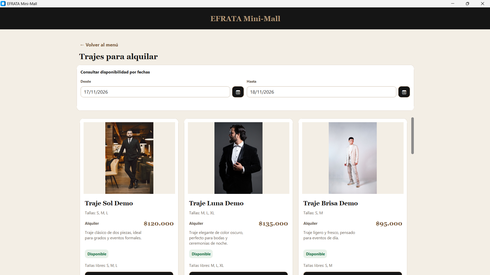
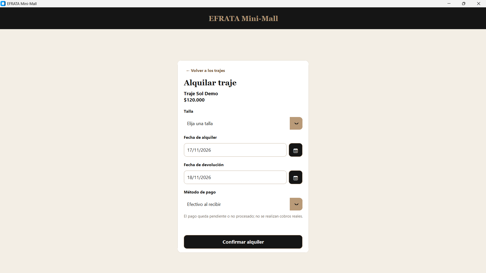
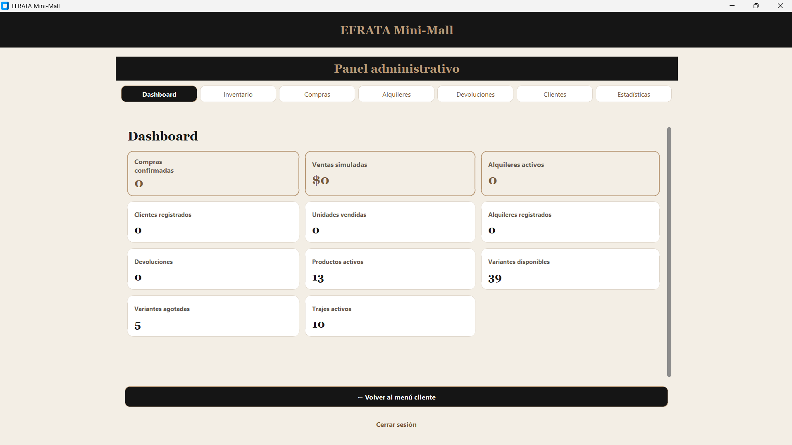

# Efrata Minimall

**Aplicación de escritorio para consultar ropa, realizar compras y gestionar alquileres de trajes.**

Proyecto académico de la **Universidad Autónoma de Occidente**, desarrollado para la asignatura **Algoritmia y Programación**. Está construido en Python, con una interfaz gráfica para clientes y administradores y almacenamiento local en archivos TXT y Excel.


## Contenido

- [Contexto, objetivos y requisitos](#contexto-y-problema)
- [Funcionalidades y capturas](#funcionalidades)
- [Arquitectura y almacenamiento](#arquitectura-y-almacenamiento)
- [Instalación y uso](#instalación-y-ejecución-en-windows)
- [Validación con usuarios y mejoras](#validación-con-usuarios-y-mejoras)
- [Pruebas técnicas y correcciones](#pruebas-técnicas-y-correcciones)
- [Fuentes de las fotografías](#fuentes-de-las-fotografías)
- [Conclusión](#conclusión)

## Contexto y problema

Efrata Minimall es un negocio de Cali, Colombia, dedicado a la venta de ropa, el alquiler de trajes y los arreglos de prendas. Para atender una compra o un alquiler es necesario consultar productos, tallas, existencias, información de contacto y, en el caso de los trajes, fechas de entrega y devolución.

Cuando esa información se consulta por separado, resulta más difícil conocer la disponibilidad y hacer seguimiento a cada operación. Por eso, este proyecto reúne las funciones principales en una aplicación: los **clientes** pueden explorar el catálogo y registrar compras o alquileres, mientras que los **administradores** pueden gestionar el inventario y consultar los movimientos del negocio.

La aplicación se centra en las ventas y los alquileres. Aunque el negocio también ofrece arreglos de ropa, ese servicio no está automatizado en esta versión.

## Objetivos y alcance

### Objetivo general

Desarrollar una aplicación de escritorio en Python que facilite la consulta de productos y la gestión de compras, alquileres e inventario de Efrata Minimall mediante una interfaz gráfica, validaciones y registros locales.

### Objetivos específicos

- Organizar la solución en módulos de usuarios, catálogo, carrito, compras, alquileres y administración.
- Permitir la consulta de prendas, tallas, precios y existencias antes de comprar.
- Verificar los datos personales necesarios para registrar compras y alquileres.
- Controlar la disponibilidad de los trajes según su talla y las fechas solicitadas.
- Conservar los registros de operaciones y los métodos de pago elegidos para su consulta posterior.
- Comprobar las funciones principales mediante pruebas con información ficticia.

### Funcionalidades priorizadas

El producto mínimo viable (MVP) se concentra en cuatro procesos: **acceso de usuarios, consulta del catálogo, compras con control de inventario y alquiler de trajes con verificación de fechas**. El carrito persistente, el historial, los comprobantes y el panel administrativo complementan esos procesos para permitir su seguimiento.

Esta versión funciona de forma **local en Windows**; no requiere servidor ni conexión con una plataforma de pagos. No está diseñada para operar simultáneamente desde varios computadores.

## Requisitos y criterios de aceptación

La siguiente tabla muestra qué debe hacer la aplicación y cómo podemos comprobar cada función.

| Requisito | ¿Cómo se comprueba? | Módulos principales |
| --- | --- | --- |
| Acceso de usuarios | Se registra una cuenta válida, se inicia sesión y las operaciones quedan asociadas al usuario correspondiente. | `backend/usuarios.py`, `backend/sesion.py` |
| Perfil obligatorio | No se confirma una compra ni un alquiler si falta alguno de los siete datos personales exigidos. | `backend/datos_personales.py`, `backend/compras.py`, `backend/alquileres.py` |
| Catálogo de ropa | Se pueden consultar productos y buscar o filtrar por las opciones disponibles en la interfaz. | `backend/catalogo.py`, `frontend/app.py` |
| Carrito persistente | Los artículos se conservan al cerrar sesión y desaparecen al comprarlos o eliminarlos manualmente. | `backend/carrito.py`, `backend/usuarios.py` |
| Compra e inventario | Se rechazan cantidades sin existencias; una compra confirmada registra el pedido, descuenta unidades, genera comprobante y actualiza el carrito. | `backend/compras.py` |
| Cancelación de compra | Cancelar antes de confirmar no altera el carrito ni el inventario. | `backend/compras.py` |
| Disponibilidad de trajes | Se validan estado, talla, fecha de inicio no anterior a hoy y fecha de devolución posterior; se rechazan cruces con otros alquileres y el margen de revisión de dos días. | `backend/alquileres.py` |
| Devoluciones | El cliente registra una devolución válida y el alquiler conserva su historial. | `backend/alquileres.py` |
| Métodos de pago | Se guarda el método y el estado del pago; los formularios de tarjeta rechazan datos incompletos o inválidos. | `backend/compras.py`, `backend/alquileres.py`, `frontend/app.py` |
| Administración | Solo las cuentas autorizadas pueden acceder a las funciones administrativas. | `backend/administracion.py` |

## Funcionalidades

### Clientes

- **Cuentas:** registro, inicio y cierre de sesión. El registro admite correos de Gmail o Hotmail (con la excepción reservada de la cuenta de demostración) y contraseñas de al menos ocho caracteres, con mayúscula, minúscula y número.
- **Datos personales:** consulta y actualización del perfil. Para comprar o alquilar se requieren nombre, apellidos, teléfono, tipo y número de documento, dirección y código postal.
- **Catálogo:** fotografías, descripciones, precios, tallas, búsquedas y filtros. La colección de demostración contiene **14 prendas registradas (13 activas)** y **10 trajes de alquiler**.
- **Favoritos y carrito:** artículos asociados a cada cuenta, con posibilidad de cambiar cantidades o eliminarlos. El carrito se conserva entre sesiones.
- **Compras:** validación de existencias, registro de pedidos, comprobantes TXT e historial de compras.
- **Alquileres:** consulta de trajes disponibles, selección de talla y fechas, registro de alquileres e historial de devoluciones.

### Administradores

- Panel principal con indicadores generales.
- Registro, edición y desactivación de prendas y trajes, con precios, descripciones, fotografías, tallas y existencias.
- Consulta de compras, artículos, totales y métodos de pago.
- Seguimiento de alquileres y consulta de las devoluciones realizadas.
- Consulta de información de clientes y estadísticas del negocio.

La devolución se registra desde la cuenta del cliente; la sección administrativa permite consultar los registros correspondientes.

## Capturas de la aplicación

Las capturas corresponden a la aplicación desarrollada y muestran su funcionamiento con datos de demostración. Antes de incorporarlas, se revisó que no incluyeran información personal sensible. Las fotografías de productos son imágenes de referencia y no corresponden al inventario físico de Efrata Minimall.

### Catálogo de ropa


### Catálogo de trajes



### Formulario de alquiler



### Panel administrativo



### Validaciones y manejo de información

La aplicación comprueba campos obligatorios, formatos, cantidades, tallas y fechas antes de registrar operaciones. También muestra mensajes cuando una acción no puede completarse y restringe las herramientas administrativas a cuentas autorizadas. Para la demostración se utilizan datos ficticios y no se recopilan números completos de tarjetas ni códigos de seguridad bancarios.

### Métodos y estados de pago

| Método | Información solicitada | Estado registrado |
| --- | --- | --- |
| Efectivo al recibir | No requiere datos de tarjeta. | Pendiente |
| Tarjeta de crédito | Nombre del titular y últimos cuatro dígitos. | No procesado |
| Tarjeta débito | Nombre del titular y últimos cuatro dígitos. | No procesado |

Los formularios de tarjeta sirven para comprobar la interacción y las validaciones. **No solicitan información bancaria real, no guardan los datos introducidos y no realizan cargos.** El estado del pedido o del alquiler se muestra por separado del estado del pago.

## Catálogo de demostración y fotografías

La versión preparada para la presentación incluye **14 prendas registradas, 13 activas, y 10 trajes de alquiler**. En ropa hay **44 variantes de talla: 39 disponibles y 5 agotadas**. Estas cantidades corresponden al inventario de demostración y pueden cambiar al registrar operaciones.

Los productos, precios, tallas y existencias son **datos ficticios de uso académico** y no representan el inventario confirmado del negocio. Las **24 fotografías del catálogo** son referencias de Pexels, no imágenes de productos reales de la tienda. Sus autores y enlaces originales se encuentran en [Fuentes de las fotografías](#fuentes-de-las-fotografías).

El logotipo fue facilitado por la propietaria y contamos con su autorización para utilizarlo en el proyecto académico.

## Arquitectura y almacenamiento

El proyecto está dividido en tres partes:

1. **`frontend/`:** contiene la interfaz, las imágenes y los formularios con los que interactúan los usuarios.
2. **`backend/`:** organiza las reglas de negocio, las validaciones y el acceso a los datos.
3. **`data/`:** conserva la información local para que las operaciones puedan consultarse después de cerrar la aplicación.

### Desarrollo del backend

Desarrollamos la lógica del programa en módulos de Python para separar las funciones de usuarios, catálogo, carrito, favoritos, compras, alquileres y administración. Cada módulo se encarga de comprobar la información y realizar las operaciones correspondientes. Por ejemplo, antes de confirmar una compra se revisan los datos del cliente y las existencias; para un alquiler se comprueban la talla y las fechas, evitando reservas que coincidan. Los productos y trajes se consultan en archivos Excel, mientras que las cuentas y los movimientos se guardan en archivos TXT.

### Desarrollo del frontend

Construimos la interfaz gráfica en `frontend/app.py` utilizando CustomTkinter y Tkinter. Organizamos pantallas para el acceso, los catálogos, el carrito, las compras, los alquileres y la administración. Incorporamos formularios, botones, fotografías, filtros y selección de fechas para que los usuarios puedan realizar las operaciones sin utilizar la terminal. La interfaz llama a las funciones del backend y muestra los resultados, confirmaciones o mensajes de error.

### Resultado del desarrollo

El resultado es una aplicación de escritorio que conecta las pantallas con los registros de compras, alquileres e inventario. Las [capturas](#capturas-de-la-aplicación) muestran cómo quedó la interfaz; las [pruebas técnicas](#pruebas-técnicas-y-correcciones) documentan las comprobaciones de funcionamiento, y la [validación con usuarios](#validación-con-usuarios-y-mejoras) explica los comentarios recibidos y los ajustes que realizamos.

El recorrido general de una operación es:

```text
Cliente o administrador
        ↓
Interfaz gráfica (frontend/app.py)
        ↓
Funciones y validaciones del backend
        ↓
Archivos locales TXT / Excel
        ↓
Resultado mostrado en la interfaz
```

**Ejemplo de integración:** al confirmar una compra, el sistema verifica el perfil y las existencias, registra el pedido, actualiza el inventario, genera un comprobante y retira del carrito los artículos comprados. Si el usuario cancela antes de confirmar, el carrito y las existencias se mantienen. En los alquileres, la disponibilidad se calcula a partir del traje, la talla y los intervalos de fechas registrados.

### Estructura principal del repositorio

```text
Efrata-Minimall/
├── .gitignore
├── main.py
├── README.md
├── frontend/
│   ├── __init__.py
│   ├── app.py
│   └── imagenes/
│       ├── CL-*.jpg (14 fotografías de ropa)
│       ├── T001.jpg … T010.jpg (10 fotografías de trajes)
│       ├── efrata_logo_ui.png
│       ├── catalogo-ropa.png
│       ├── catalogo-trajes.png
│       ├── formulario-alquiler.png
│       └── panel-administrativo.png
├── backend/
│   ├── __init__.py
│   ├── rutas.py
│   ├── sesion.py
│   ├── usuarios.py
│   ├── datos_personales.py
│   ├── catalogo.py
│   ├── favoritos.py
│   ├── carrito.py
│   ├── compras.py
│   ├── alquileres.py
│   └── administracion.py
├── data/
│   ├── ropa.xlsx
│   ├── inventario.xlsx
│   ├── consultardisponibilidad.txt
│   └── trajesdisponibles.txt
└── comprobantes/
    └── .gitkeep
```

El árbol muestra los archivos incluidos en GitHub. `ropa.xlsx` guarda las prendas y sus existencias, mientras que `inventario.xlsx` contiene los trajes. Al iniciar el programa se crean, si faltan, los archivos TXT necesarios para las cuentas, el carrito, las compras y los alquileres. Los registros de cada usuario y los comprobantes se guardan localmente y no se publican en el repositorio.

## Tecnologías

| Tecnología | Uso |
| --- | --- |
| **Python 3.12** | Lenguaje principal; la revisión se realizó con Python 3.12.10. |
| **CustomTkinter y Tkinter** | Ventanas, navegación, controles y mensajes. |
| **pandas** | Consulta y organización de información tabular. |
| **openpyxl** | Lectura y actualización de libros Excel. |
| **Pillow** | Carga y adaptación de fotografías. |
| **tkcalendar** | Selección de fechas en los alquileres. |
| **TXT y Excel** | Persistencia local de usuarios, productos y operaciones. |

### Datos y privacidad

El repositorio incluye los inventarios de demostración y las imágenes, pero no las cuentas ni los movimientos privados. Al iniciar el programa se crean los archivos TXT que falten, sin borrar información existente. En una instalación completamente nueva también se prepara una cuenta de administrador para la demostración, cuyos datos aparecen más adelante. Los registros de usuarios, compras y alquileres, así como los comprobantes, permanecen en el equipo.

## Instalación y ejecución en Windows

**Requisito previo:** tener instalado Python 3.12, con Tkinter disponible. No es necesario utilizar Visual Studio Code. Git es opcional si se descarga el archivo ZIP del repositorio.

1. En GitHub, seleccionar **Code → Download ZIP** y extraer el contenido. También puede utilizarse **Code** para copiar la URL y clonar el repositorio con Git.
2. Abrir PowerShell en la carpeta donde se encuentra `main.py`.
3. Crear un entorno virtual:

   ```powershell
   python -m venv .venv
   ```

4. Instalar las librerías necesarias dentro del entorno:

   ```powershell
   .\.venv\Scripts\python.exe -m pip install customtkinter pandas openpyxl Pillow tkcalendar
   ```

5. Ejecutar la aplicación:

   ```powershell
   .\.venv\Scripts\python.exe main.py
   ```

Estos comandos no requieren activar el entorno virtual ni modificar la política de ejecución de PowerShell. Si se prefiere usar la instalación de Python que ya está configurada en el equipo, también puede ejecutarse `python main.py` después de instalar las dependencias correspondientes.

**Importante:** mantener las carpetas `backend/`, `frontend/`, `data/` y las fotografías en su ubicación original. Para las pruebas o demostraciones, utilizar una copia de trabajo y datos ficticios, especialmente si ya existen operaciones registradas.

## Guía de uso

### Como cliente

1. Registrarse o iniciar sesión. En **Mis datos**, completar y guardar los siete campos obligatorios.
2. Entrar en **Buscar ropa**, utilizar los filtros, elegir un producto y seleccionar una talla disponible.
3. Agregar productos a **Favoritos** o **Ver carrito** y ajustar las cantidades.
4. Seleccionar un método de pago, confirmar la compra y consultar **Mis compras** y el comprobante generado.
5. Entrar en **Alquilar trajes**, consultar tallas y fechas disponibles y registrar el alquiler.
6. En **Consultar alquileres**, revisar el historial y registrar la devolución cuando corresponda.

En ventanas pequeñas, puede ser necesario desplazar el menú hasta abajo para acceder a **Cerrar sesión**.

## Acceso de administrador

Para probar las funciones administrativas en una **instalación nueva**, ejecutar `python main.py` e iniciar sesión con esta cuenta de demostración:

| Dato | Credencial |
| --- | --- |
| Correo | `admin@efrata.invalid` |
| Contraseña | `EfrataDemo2026!` |

La cuenta se crea automáticamente solo cuando todavía no existen archivos de usuarios u operaciones. **Si ya se ha utilizado la aplicación, se conservan las cuentas existentes y no se añade esta cuenta de prueba.** El correo de demostración no es una dirección real y estas credenciales deben utilizarse únicamente para el proyecto académico.

### Como administrador

1. Iniciar sesión con la cuenta de demostración o con una cuenta que ya tenga permisos administrativos.
2. Abrir el **Panel administrativo** para consultar el resumen del negocio.
3. Revisar o actualizar el inventario de prendas y trajes.
4. Consultar compras, alquileres, devoluciones, clientes y estadísticas.

Para la sustentación, utilizar datos ficticios y evitar mostrar información personal o contraseñas privadas.

## Validación con usuarios y mejoras

Para evaluar la utilidad y la facilidad de uso de Efrata Minimall, realizamos actividades de campo con personas que podían utilizar el sistema como clientes o desde el negocio. En una primera etapa presentamos dos propuestas de interfaz y una versión inicial que funcionaba en la terminal. Posteriormente, recopilamos fotografías y videos de personas utilizando la aplicación gráfica.

### Participantes y desarrollo de las pruebas

En la validación inicial participaron cuatro personas con diferentes perfiles. Se les pidió explorar las opciones, buscar un traje, consultar su información y reconocer cómo realizarían un alquiler. Durante las actividades registramos sus respuestas, dificultades y sugerencias.

| Participante | Perfil | Principales observaciones |
| --- | --- | --- |
| 1 | Persona de 19 años, maquilladora profesional | Comprendió el propósito de la aplicación y consideró claras las opciones. Indicó que podía completar la tarea sin ayuda y sugirió contar con más alternativas de trajes. |
| 2 | Persona de 46 años, abogada | Encontró comprensible la información y destacó la importancia de ofrecer más opciones para alquilar. Manifestó que utilizaría una aplicación de este tipo. |
| 3 | Mujer de 38 años, empleada del negocio | Consideró útil la búsqueda de trajes, aunque algunas opciones de la versión en terminal le resultaron confusas. Recomendó una presentación más visual y descripciones más completas de las prendas. |
| 4 | Persona de 45 años, propietaria del negocio | Resaltó la importancia de organizar los alquileres y las devoluciones, y de consultar la disponibilidad de cada traje según la talla y las fechas solicitadas. |

Estas observaciones corresponden a la evaluación de los diseños y del programa inicial. Sirvieron como orientación para el desarrollo, pero no deben interpretarse como resultados de una prueba completa de la versión final.

### Evidencias del trabajo de campo

Las pruebas posteriores se documentaron con fotografías y videos en los que se observa la interacción con la aplicación gráfica. Los registros muestran recorridos por el inicio de sesión, el catálogo de productos, los formularios y la selección de fechas para alquileres.

El material se presenta de manera general, sin asignar cada fotografía a un participante. Los comentarios y las respuestas se conservan organizados por persona en el registro de validación inicial.

**[Consultar las evidencias fotográficas y audiovisuales en Google Drive](https://drive.google.com/drive/folders/1AQ-JaSVIc6e9VyRthsJdaCWF0V2aFu36?usp=sharing)**

La carpeta contiene 16 fotografías y cinco videos. Las imágenes permiten observar la participación y el uso de distintas pantallas.

### Comentarios recibidos y cambios realizados

| Observación de los participantes | Cambio realizado |
| --- | --- |
| Algunas opciones del programa en terminal no eran fáciles de interpretar. | Se desarrolló una interfaz gráfica con botones, formularios y navegación entre pantallas. |
| Hacían falta más alternativas y una presentación más completa de los productos. | Se amplió el catálogo de demostración y se incorporaron imágenes de referencia, descripciones, tallas y precios. |
| Era importante consultar las fechas de alquiler y evitar reservas que coincidieran. | Se incorporó la verificación de disponibilidad por traje, talla y período, junto con el registro y la consulta de devoluciones. |
| Al agregar un producto al carrito o a favoritos, algunos usuarios no se daban cuenta de que la acción se había realizado. | Se añadió un mensaje en la parte inferior de la pantalla para confirmar cuando se agrega un producto al carrito o a favoritos. |

Sobre el último punto, nuestra compañera recogió comentarios de usuarios que, en general, entendían cómo navegar por la aplicación, pero no siempre notaban si el producto se había guardado en el carrito o en favoritos. Después de incorporar los mensajes de confirmación, se comprobó que los avisos aparecían y se visualizaban correctamente.

Las actividades nos ayudaron a reconocer qué información necesitaban consultar los clientes, qué funciones eran importantes para el negocio y qué aspectos de la interfaz debíamos mejorar.

---

## Pruebas técnicas y correcciones

Durante el desarrollo ejecutamos **32 pruebas automatizadas, todas aprobadas**. Comprobamos las funciones principales con datos correctos, incorrectos y casos límite. Para evitar cambios en los registros del proyecto, utilizamos información ficticia y archivos temporales.

| Área evaluada | Aspectos comprobados | Resultado |
| --- | --- | --- |
| Catálogo e interfaz | Productos, existencias, fotografías, búsqueda y filtros. | Aprobado |
| Usuarios y perfiles | Registro, acceso, contraseñas, permisos y campos obligatorios. | Aprobado |
| Carrito y compras | Persistencia, cantidades, inventario, cancelación y comprobantes. | Aprobado |
| Pagos simulados | Métodos disponibles, estados y validaciones de formularios. | Aprobado |
| Alquileres y devoluciones | Tallas, fechas, disponibilidad, reservas coincidentes y devoluciones. | Aprobado |
| Administración e integración | Consultas, edición de inventario y comunicación entre interfaz, lógica y archivos. | Aprobado |

Durante el desarrollo se ajustaron validaciones de usuarios y formularios, el control de existencias, la disponibilidad de trajes y la presentación de mensajes y estados de pago. Después de los cambios se volvieron a comprobar las funciones correspondientes. Las observaciones de uso y las mejoras realizadas a partir de ellas se explican en [Validación con usuarios y mejoras](#validación-con-usuarios-y-mejoras).

Conservamos a continuación el registro de resultados de las 32 pruebas. Los archivos con los que se ejecutaron ya no forman parte de esta entrega, por lo que el registro permite consultar los resultados, pero no volver a ejecutar esas pruebas desde GitHub.

<a id="registro-32-pruebas"></a>
<details>
<summary>Ver registro de las 32 pruebas</summary>

```text
Ejecución antes de retirar la suite. Resultado histórico; los archivos de pruebas serán eliminados.
Comando ejecutado: python -B -m unittest discover -s tests -v

customtkinter.windows.widgets.font warning: Preferred drawing method 'font_shapes' can not be used because the font file could not be loaded.
Using 'circle_shapes' instead. The rendering quality will be bad!
test_00_ampliacion_dentro_de_pantalla (test_catalogo.CatalogoAmpliado.test_00_ampliacion_dentro_de_pantalla) ... ok
test_01_catalogos_y_existencias (test_catalogo.CatalogoAmpliado.test_01_catalogos_y_existencias) ... ok
test_02_fotos_fuentes_y_apertura (test_catalogo.CatalogoAmpliado.test_02_fotos_fuentes_y_apertura) ... ok
test_03_busqueda_filtros_y_tarjetas (test_catalogo.CatalogoAmpliado.test_03_busqueda_filtros_y_tarjetas) ... ok
test_04_carrito_compra_y_stock (test_catalogo.CatalogoAmpliado.test_04_carrito_compra_y_stock) ... ok
test_05_alquiler_conflicto_y_registro_historico (test_catalogo.CatalogoAmpliado.test_05_alquiler_conflicto_y_registro_historico) ... ok
test_06_inventario_administrativo (test_catalogo.CatalogoAmpliado.test_06_inventario_administrativo) ... ok
test_01_registro_acceso_hash_duplicado (test_criticos.BackendCritico.test_01_registro_acceso_hash_duplicado)
Acceso | Registro, hash y duplicado | Cuenta única, hash PBKDF2 y acceso válido. ... ok
test_02_formatos_registro_invalidos (test_criticos.BackendCritico.test_02_formatos_registro_invalidos)
Acceso | Correo y contraseña inválidos | Rechazo sin escribir cuentas. ... ok
test_03_operaciones_sin_sesion_y_otro_usuario (test_criticos.BackendCritico.test_03_operaciones_sin_sesion_y_otro_usuario)
Seguridad | Sin sesión y cuenta ajena | PermissionError sin escrituras. ... ok
test_04_siete_campos_obligatorios (test_criticos.BackendCritico.test_04_siete_campos_obligatorios)
Perfil | Cada campo vacío individualmente | Compra y alquiler bloqueados sin escrituras. ... ok
test_05_perfil_ausente (test_criticos.BackendCritico.test_05_perfil_ausente)
Perfil | Perfil inexistente | Ambas operaciones bloqueadas sin archivos nuevos. ... ok
test_06_tres_metodos_y_estados (test_criticos.BackendCritico.test_06_tres_metodos_y_estados)
Pagos | Tres métodos y perfil válido | Método y estado conservados en ambas operaciones. ... ok
test_07_metodos_invalidos (test_criticos.BackendCritico.test_07_metodos_invalidos)
Pagos | Método no permitido | ValueError y datos temporales intactos. ... ok
test_08_carritos_separados (test_criticos.BackendCritico.test_08_carritos_separados)
Carrito | Dos usuarios ficticios | Compra de uno conserva el carrito del otro. ... ok
test_09_cantidades_invalidas (test_criticos.BackendCritico.test_09_cantidades_invalidas)
Carrito | Cero, negativos, fracciones y exceso | Rechazo sin modificar carrito ni stock. ... ok
test_10_compra_stock_exacto_comprobante_historial (test_criticos.BackendCritico.test_10_compra_stock_exacto_comprobante_historial)
Compra | Comprar todas las existencias | Stock cero, pedido y comprobante correctos; carrito vacío. ... ok
test_11_cancelacion (test_criticos.BackendCritico.test_11_cancelacion)
Compra | Cancelar confirmación | Inventario, carrito y registros sin cambios. ... ok
test_12_stock_reducido_antes_de_comprar (test_criticos.BackendCritico.test_12_stock_reducido_antes_de_comprar)
Compra | Inventario menor que carrito guardado | Compra rechazada y carrito conservado. ... ok
test_13_carrito_en_proceso_nuevo (test_criticos.BackendCritico.test_13_carrito_en_proceso_nuevo)
Persistencia | Leer carrito desde otro intérprete | Recuperar exactamente artículo, talla y cantidad. ... ok
test_14_fechas_invalidas (test_criticos.BackendCritico.test_14_fechas_invalidas)
Alquiler | Formatos, fecha pasada y devolución no posterior | Rechazo sin escrituras. ... ok
test_15_tallas_y_trajes_invalidos (test_criticos.BackendCritico.test_15_tallas_y_trajes_invalidos)
Alquiler | Talla inexistente y traje inactivo o ausente | Rechazo sin registros. ... ok
test_16_limites_revision_dos_dias (test_criticos.BackendCritico.test_16_limites_revision_dos_dias)
Disponibilidad | Último día de revisión y día siguiente | Rechazo hasta devolución +2; aceptación en +3. ... ok
test_17_devolucion_y_pago_conservado (test_criticos.BackendCritico.test_17_devolucion_y_pago_conservado)
Devolución | Devolver desde el día de inicio y repetir | Fecha real y pago conservados; repetición rechazada. ... ok
test_18_devolucion_anticipada (test_criticos.BackendCritico.test_18_devolucion_anticipada)
Devolución | Antes del inicio | Rechazo conservando el alquiler activo. ... ok
test_19_administracion_denegada (test_criticos.BackendCritico.test_19_administracion_denegada)
Administración | Cuenta normal | Consultas y modificación denegadas sin cambios. ... ok
test_20_administracion_autorizada (test_criticos.BackendCritico.test_20_administracion_autorizada)
Administración | Consultar y modificar copias | Operaciones visibles y existencias actualizadas sin perder registros. ... ok
test_21_tarjetas_invalidas_formularios (test_criticos.Formularios.test_21_tarjetas_invalidas_formularios)
Interfaz | Tarjetas incompletas e inválidas | Ambos formularios rechazan sin escrituras. ... ok
test_22_compra_y_alquiler_desde_formularios (test_criticos.Formularios.test_22_compra_y_alquiler_desde_formularios)
Integración gráfica | Enviar widgets reales con tres métodos | Pedido, comprobante, stock y alquiler persistidos; tarjeta no guardada. ... ok
test_23_panel_administrativo_real (test_criticos.Formularios.test_23_panel_administrativo_real)
Interfaz administrativa | Panel autorizado | Panel visible y consulta del inventario temporal. ... ok
test_24_edicion_administrativa_formulario (test_criticos.Formularios.test_24_edicion_administrativa_formulario)
Integración administrativa | Guardar edición de traje desde widgets | Precio y descripción persisten en Excel temporal. ... ok
test_25_etiquetas_y_compatibilidad_historica (test_criticos.Formularios.test_25_etiquetas_y_compatibilidad_historica)
Presentación | Estados históricos y etiquetas nuevas | Mostrar No procesado sin reescribir registros; indicador de pedidos claro. ... ok

----------------------------------------------------------------------
Ran 32 tests in 29.888s

OK

Verificaciones posteriores a la simplificación (18 de noviembre de 2026):
- Inicialización en directorio temporal: ocho TXT vacíos creados desde las plantillas; archivo existente conservado al reinicializar.
- Copia temporal de los archivos públicos actuales, sin cuentas ni comprobantes privados: entrada main.py ejecutada; interfaz Tk abierta y cerrada mediante temporizador, sin operaciones de negocio.
- Aviso de CustomTkinter: fuente font_shapes no disponible; utilizó circle_shapes. No impidió el arranque.
- Compilación en memoria de los 14 archivos Python restantes: correcta, sin generar bytecode.
- Cuatro capturas del README abiertas y verificadas con Pillow; 17 enlaces relativos de README e informes Markdown resueltos.
- Integridad SHA-256: 58 archivos de datos, comprobantes, fotografías y capturas sin cambios; respaldo completo con .git sin cambios.
```

</details>

## Fuentes de las fotografías

Las 24 fotografías del catálogo proceden de Pexels y se utilizan únicamente como referencias visuales para los productos de demostración. No corresponden a prendas fotografiadas en Efrata Minimall. Se conservaron las fichas de origen de cada imagen y se tomó como referencia la [licencia de Pexels](https://www.pexels.com/license/). Los precios, las descripciones, las tallas y las existencias del catálogo son ficticios.

<details>
<summary>Consultar autores y fotografías originales</summary>

| Imagen del catálogo | Autor o autora | Fuente |
| --- | --- | --- |
| `CL-MU-001.jpg` | picko pictura | [Ver fotografía](https://www.pexels.com/photo/young-woman-in-yellow-blouse-on-urban-street-40867948/) |
| `CL-MU-002.jpg` | Valerie Voila | [Ver fotografía](https://www.pexels.com/photo/woman-wearing-a-long-loose-dress-13727333/) |
| `CL-MU-003.jpg` | Polina Tankilevitch | [Ver fotografía](https://www.pexels.com/photo/woman-in-a-black-midi-skirt-black-boots-and-red-socks-7391123/) |
| `CL-HO-001.jpg` | cottonbro studio | [Ver fotografía](https://www.pexels.com/photo/a-person-wearing-a-long-sleeve-shirt-7764063/) |
| `CL-HO-002.jpg` | Elina Volkova | [Ver fotografía](https://www.pexels.com/photo/a-man-in-a-white-sweater-and-tan-pants-16238583/) |
| `CL-UNI-001.jpg` | Santiago Sauceda González | [Ver fotografía](https://www.pexels.com/photo/selective-focus-of-a-man-wearing-his-bomber-jacket-10024417/) |
| `T001.jpg` | Gustavo Fring | [Ver fotografía](https://www.pexels.com/photo/a-man-wearing-a-black-suit-6284888/) |
| `T002.jpg` | Puskar Rai | [Ver fotografía](https://www.pexels.com/photo/a-bearded-man-wearing-black-suit-13849227/) |
| `T003.jpg` | Bruno Casttro | [Ver fotografía](https://www.pexels.com/photo/elegant-man-in-stylish-cream-suit-fashion-portrait-29242239/) |
| `T004.jpg` | zaid mohammed | [Ver fotografía](https://www.pexels.com/photo/man-in-gray-suit-jacket-11982600/) |
| `T005.jpg` | Taiye Salawu | [Ver fotografía](https://www.pexels.com/photo/confident-man-in-tuxedo-posing-outdoors-37263479/) |
| `CL-MU-004.jpg` | cottonbro studio | [Ver fotografía](https://www.pexels.com/photo/a-person-wearing-white-blouse-7716936/) |
| `CL-MU-005.jpg` | Vika Glitter | [Ver fotografía](https://www.pexels.com/photo/a-woman-wearing-floral-dress-8305929/) |
| `CL-MU-006.jpg` | Maksim Goncharenok | [Ver fotografía](https://www.pexels.com/photo/a-person-wearing-a-pleated-skirt-4663319/) |
| `CL-UNI-002.jpg` | Antoni Shkraba | [Ver fotografía](https://www.pexels.com/photo/blue-denim-button-up-jacket-6843224/) |
| `CL-HO-003.jpg` | Jonathan Borba | [Ver fotografía](https://www.pexels.com/photo/minimalist-white-shirt-hanging-on-hanger-28576622/) |
| `CL-MU-007.jpg` | José Martin Segura Benites | [Ver fotografía](https://www.pexels.com/photo/woman-wearing-beige-trousers-on-a-pavement-27081006/) |
| `CL-HO-004.jpg` | Dennis Ojenomoh | [Ver fotografía](https://www.pexels.com/photo/portrait-of-a-man-in-a-blue-shirt-posing-with-his-arms-crossed-12529233/) |
| `CL-MU-008.jpg` | Daniel Neves Cotta | [Ver fotografía](https://www.pexels.com/photo/studio-shot-of-a-young-woman-wearing-a-jacket-20016578/) |
| `T006.jpg` | Jonathan Borba | [Ver fotografía](https://www.pexels.com/photo/a-man-wearing-a-blue-suit-12031208/) |
| `T007.jpg` | Sandeep Singh | [Ver fotografía](https://www.pexels.com/photo/bearded-man-wearing-his-beige-suit-5856080/) |
| `T008.jpg` | Tima Miroshnichenko | [Ver fotografía](https://www.pexels.com/photo/man-wearing-black-suit-6766361/) |
| `T009.jpg` | Varun Ish Nanda | [Ver fotografía](https://www.pexels.com/photo/man-in-black-suit-17420227/) |
| `T010.jpg` | PNW Production | [Ver fotografía](https://www.pexels.com/photo/man-wearing-a-gray-suit-8276133/) |

</details>

El logotipo fue proporcionado por el negocio y cuenta con su autorización de uso académico. Las fotografías del catálogo, en cambio, se atribuyen a sus respectivos autores de Pexels.

## Limitaciones y mejoras futuras

- **Uso local:** los datos se almacenan en TXT y Excel; no hay base de datos centralizada ni sincronización entre equipos.
- **Pagos:** los formularios de tarjeta son académicos y no procesan transacciones bancarias.
- **Entregas:** no hay integración con servicios de transporte ni seguimiento real de envíos.
- **Arreglos de ropa:** es un servicio del negocio, pero no cuenta con un módulo de gestión dentro del programa.
- **Seguridad y escalabilidad:** los permisos administrativos dependen de archivos locales. Esta versión está pensada para demostración académica y no para operación comercial en red.

En una versión futura podrían incorporarse una base de datos compartida, fotografías del inventario real, la gestión de arreglos y servicios de pago y entrega, con las medidas de seguridad necesarias.

## Conclusión

Efrata Minimall reúne en una sola aplicación la consulta de prendas y trajes, el registro de compras y alquileres, la verificación de disponibilidad según las fechas solicitadas y el seguimiento de las operaciones. Las pruebas técnicas realizadas y los comentarios de las personas participantes permitieron comprobar las funciones principales y realizar mejoras en la interfaz. Aunque se trata de un proyecto académico de uso local, la solución responde a las necesidades de organización que identificamos durante su desarrollo.

## Créditos académicos

- **Universidad:** Universidad Autónoma de Occidente (UAO).
- **Asignatura:** Algoritmia y Programación.
- **Año:** 2026.
- **Integrantes:** Isabella Caro Giraldo y Allison Castrillón Núñez.
- **Docente:** Juan Manuel Nuñez Velasco.
