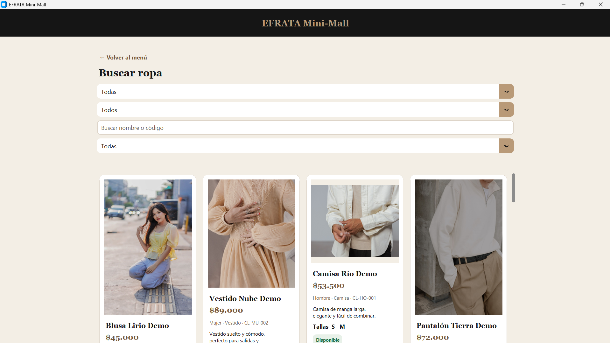

# Efrata Minimall

**Aplicación de escritorio para consultar ropa, realizar compras y gestionar alquileres de trajes.**

Proyecto académico de la **Universidad Autónoma de Occidente (UAO)**, desarrollado en 2026 para la asignatura **Algoritmia y Programación**. Está construido en Python, con una interfaz gráfica para clientes y administradores y almacenamiento local en archivos TXT y Excel.

## Contexto y problema

Efrata Minimall es un negocio de Cali, Colombia, dedicado a la venta de ropa, el alquiler de trajes y los arreglos de prendas. Para atender una compra o un alquiler es necesario consultar productos, tallas, existencias, información de contacto y, en el caso de los trajes, fechas de entrega y devolución.

Cuando esa información se consulta por separado, resulta más difícil conocer la disponibilidad y hacer seguimiento a cada operación. Por eso, este proyecto reúne las funciones principales en una aplicación: los **clientes** pueden explorar el catálogo y registrar compras o alquileres, mientras que los **administradores** pueden gestionar el inventario y consultar los movimientos del negocio.

La aplicación se centra en las ventas y los alquileres. Aunque el negocio también ofrece arreglos de ropa, ese servicio no está automatizado en esta versión.

## Objetivos y alcance

### Objetivo general

Desarrollar una aplicación de escritorio en Python que facilite la consulta de productos y la gestión de compras, alquileres e inventario de Efrata Minimall mediante una interfaz gráfica, validaciones y registros locales.

### Objetivos específicos

- Organizar la solución en módulos de usuarios, catálogo, carrito, compras, alquileres y administración.
- Permitir la consulta de prendas, tallas, precios y existencias antes de comprar.
- Verificar los datos personales necesarios para registrar compras y alquileres.
- Controlar la disponibilidad de los trajes según su talla y las fechas solicitadas.
- Conservar los registros de operaciones y los métodos de pago elegidos para su consulta posterior.
- Comprobar las funciones principales mediante pruebas con información ficticia.

### Funcionalidades priorizadas

El producto mínimo viable (MVP) se concentra en cuatro procesos: **acceso de usuarios, consulta del catálogo, compras con control de inventario y alquiler de trajes con verificación de fechas**. El carrito persistente, el historial, los comprobantes y el panel administrativo complementan esos procesos para permitir su seguimiento.

Esta versión funciona de forma **local en Windows**; no requiere servidor ni conexión con una plataforma de pagos. No está diseñada para operar simultáneamente desde varios computadores.

## Requisitos y criterios de aceptación

Cada requisito se relaciona con una condición observable y con los módulos donde se implementa. Estos criterios también sirven como guía para las pruebas y la sustentación.

| Requisito | ¿Cómo se comprueba? | Módulos principales |
| --- | --- | --- |
| Acceso de usuarios | Se registra una cuenta válida, se inicia sesión y las operaciones quedan asociadas al usuario correspondiente. | `backend/usuarios.py`, `backend/sesion.py` |
| Perfil obligatorio | No se confirma una compra ni un alquiler si falta alguno de los siete datos personales exigidos. | `backend/datos_personales.py`, `backend/compras.py`, `backend/alquileres.py` |
| Catálogo de ropa | Se pueden consultar productos y buscar o filtrar por las opciones disponibles en la interfaz. | `backend/catalogo.py`, `frontend/app.py` |
| Carrito persistente | Los artículos se conservan al cerrar sesión y desaparecen al comprarlos o eliminarlos manualmente. | `backend/carrito.py`, `backend/usuarios.py` |
| Compra e inventario | Se rechazan cantidades sin existencias; una compra confirmada registra el pedido, descuenta unidades, genera comprobante y actualiza el carrito. | `backend/compras.py` |
| Cancelación de compra | Cancelar antes de confirmar no altera el carrito ni el inventario. | `backend/compras.py` |
| Disponibilidad de trajes | Se validan estado, talla, fecha de inicio no anterior a hoy y fecha de devolución posterior; se rechazan cruces con otros alquileres y el margen de revisión de dos días. | `backend/alquileres.py` |
| Devoluciones | El cliente registra una devolución válida y el alquiler conserva su historial. | `backend/alquileres.py` |
| Métodos de pago | Se guarda el método y el estado del pago; los formularios de tarjeta rechazan datos incompletos o inválidos. | `backend/compras.py`, `backend/alquileres.py`, `frontend/app.py` |
| Administración | Solo las cuentas autorizadas pueden acceder a las funciones administrativas. | `backend/administracion.py` |

## Funcionalidades

### Clientes

- **Cuentas:** registro, inicio y cierre de sesión. El registro admite correos de Gmail o Hotmail y contraseñas de al menos ocho caracteres, con mayúscula, minúscula y número.
- **Datos personales:** consulta y actualización del perfil. Para comprar o alquilar se requieren nombre, apellidos, teléfono, tipo y número de documento, dirección y código postal.
- **Catálogo:** fotografías, descripciones, precios, tallas, búsquedas y filtros. La colección de demostración contiene **14 prendas registradas (13 activas)** y **10 trajes de alquiler**.
- **Favoritos y carrito:** artículos asociados a cada cuenta, con posibilidad de cambiar cantidades o eliminarlos. El carrito se conserva entre sesiones.
- **Compras:** validación de existencias, registro de pedidos, comprobantes TXT e historial de compras.
- **Alquileres:** consulta de trajes disponibles, selección de talla y fechas, registro de alquileres e historial de devoluciones.

### Administradores

- Panel principal con indicadores generales.
- Registro, edición y desactivación de prendas y trajes, con precios, descripciones, fotografías, tallas y existencias.
- Consulta de compras, artículos, totales y métodos de pago.
- Seguimiento de alquileres y consulta de las devoluciones realizadas.
- Consulta de información de clientes y estadísticas del negocio.

La devolución se registra desde la cuenta del cliente; la sección administrativa permite consultar los registros correspondientes.

## Capturas de la aplicación

Las capturas reales incorporadas fueron tomadas el **17 de noviembre de 2026** y muestran la interfaz con datos de demostración. Se revisaron antes de incluirlas y no se observaron datos personales sensibles. Las fotografías de productos son referencias, no imágenes tomadas del inventario físico de Efrata Minimall.

### Catálogo de ropa



### Catálogo de trajes


### Formulario de alquiler


### Panel administrativo


### Validaciones y manejo de información

La aplicación comprueba campos obligatorios, formatos, cantidades, tallas y fechas antes de registrar operaciones. También muestra mensajes cuando una acción no puede completarse y restringe las herramientas administrativas a cuentas autorizadas. Para la demostración se utilizan datos ficticios y no se recopilan números completos de tarjetas ni códigos de seguridad bancarios.

### Métodos y estados de pago

| Método | Información solicitada | Estado registrado |
| --- | --- | --- |
| Efectivo al recibir | No requiere datos de tarjeta. | Pendiente |
| Tarjeta de crédito | Nombre del titular y últimos cuatro dígitos. | No procesado |
| Tarjeta débito | Nombre del titular y últimos cuatro dígitos. | No procesado |

Los formularios de tarjeta sirven para comprobar la interacción y las validaciones. **No solicitan información bancaria real, no guardan los datos introducidos y no realizan cargos.** El estado del pedido o del alquiler se muestra por separado del estado del pago.

## Catálogo de demostración y fotografías

La versión preparada para la presentación incluye **14 prendas registradas, 13 activas, y 10 trajes de alquiler**. En ropa hay **44 variantes de talla: 39 disponibles y 5 agotadas**. Estas cifras se comprobaron en el inventario el **17 de noviembre de 2026** y pueden cambiar al registrar operaciones.

Los productos añadidos, así como sus precios, tallas y existencias, son **datos ficticios de uso académico**; no representan cantidades ni precios confirmados por el establecimiento. Las **24 fotografías del catálogo** son referencias de Pexels, cuya procedencia y condiciones de uso se documentaron en [`docs/catalogo_referencia.txt`](docs/catalogo_referencia.txt) y en los informes de [ampliación](docs/AMPLIACION_CATALOGO.md) y [sustitución](docs/SUSTITUCION_FOTOGRAFIAS.md). No deben interpretarse como fotografías de productos reales de la tienda.

El logotipo corresponde a la identidad visual de Efrata Minimall y fue facilitado por su propietaria para el proyecto académico. Las fotografías de referencia y el logotipo tienen procedencias distintas.

## Arquitectura y almacenamiento

El proyecto está dividido en tres partes:

1. **`frontend/`:** contiene la interfaz, las imágenes y los formularios con los que interactúan los usuarios.
2. **`backend/`:** organiza las reglas de negocio, las validaciones y el acceso a los datos.
3. **`data/`:** conserva la información local para que las operaciones puedan consultarse después de cerrar la aplicación.

El recorrido general de una operación es:

```text
Cliente o administrador
        ↓
Interfaz gráfica (frontend/app.py)
        ↓
Funciones y validaciones del backend
        ↓
Archivos locales TXT / Excel
        ↓
Resultado mostrado en la interfaz
```

**Ejemplo de integración:** al confirmar una compra, el sistema verifica el perfil y las existencias, registra el pedido, actualiza el inventario, genera un comprobante y retira del carrito los artículos comprados. Si el usuario cancela antes de confirmar, el carrito y las existencias se mantienen. En los alquileres, la disponibilidad se calcula a partir del traje, la talla y los intervalos de fechas registrados.

### Estructura principal del repositorio

```text
Efrata-Minimall/
├── main.py
├── README.md
├── frontend/
│   ├── app.py
│   └── imagenes/
├── backend/
│   ├── __init__.py
│   ├── rutas.py
│   ├── sesion.py
│   ├── usuarios.py
│   ├── datos_personales.py
│   ├── catalogo.py
│   ├── favoritos.py
│   ├── carrito.py
│   ├── compras.py
│   ├── alquileres.py
│   └── administracion.py
├── data/
│   ├── usuarios.txt
│   ├── administradores.txt
│   ├── iniciossesion.txt
│   ├── datos_personales.txt
│   ├── favoritos.txt
│   ├── carrito.txt
│   ├── compras.txt
│   ├── registraralquiler.txt
│   ├── ropa.xlsx
│   └── inventario.xlsx
├── docs/
│   ├── capturas/
│   ├── catalogo_referencia.txt
│   ├── AMPLIACION_CATALOGO.md
│   ├── SUSTITUCION_FOTOGRAFIAS.md
│   ├── PRUEBAS_TECNICAS_ENTREGA.md
│   └── RESULTADOS_PRUEBAS_TECNICAS.txt
├── tests/
│   ├── test_catalogo.py
│   └── test_criticos.py
└── comprobantes/
    └── comprobantes TXT generados por las compras
```

El árbol resume los elementos principales; el nombre de la carpeta raíz puede variar al descargar el proyecto. `ropa.xlsx` contiene las hojas **Productos** y **Existencias**; `inventario.xlsx` almacena los trajes. Los archivos TXT conservan usuarios, carritos, favoritos y operaciones. Los identificadores y correos permiten relacionar los registros correspondientes. `docs/` reúne fuentes de las fotografías y capturas de la interfaz; `tests/` contiene las pruebas del catálogo y de las funciones críticas.

## Tecnologías

| Tecnología | Uso |
| --- | --- |
| **Python 3.12** | Lenguaje principal; la revisión se realizó con Python 3.12.10. |
| **CustomTkinter y Tkinter** | Ventanas, navegación, controles y mensajes. |
| **pandas** | Consulta y organización de información tabular. |
| **openpyxl** | Lectura y actualización de libros Excel. |
| **Pillow** | Carga y adaptación de fotografías. |
| **tkcalendar** | Selección de fechas en los alquileres. |
| **TXT y Excel** | Persistencia local de usuarios, productos y operaciones. |

### Datos iniciales y privacidad de la descarga pública

Los inventarios Excel y las fotografías se incluyen completos. Los archivos operativos de cuentas, perfiles, accesos, carrito, favoritos, compras y alquileres se crean vacíos al ejecutar `python main.py`, a partir de `data/plantillas/`. `inicializar_datos.py` solo crea archivos ausentes: nunca sobrescribe datos existentes. Los nombres y formatos TXT utilizados por el backend se conservan.

Los TXT operativos y los comprobantes generados están excluidos por `.gitignore`. No contienen cuentas preconfiguradas en una descarga nueva. Para usar la aplicación se registra una cuenta propia; para administrar, el responsable añade localmente el correo de una cuenta registrada a `data/administradores.txt`. Ese archivo no debe publicarse. Los comprobantes se guardan en `comprobantes/` únicamente de forma local.

## Instalación y ejecución en Windows

**Requisito previo:** tener instalado Python 3.12, con Tkinter disponible. No es necesario utilizar Visual Studio Code. Git es opcional si se descarga el archivo ZIP del repositorio.

1. En GitHub, seleccionar **Code → Download ZIP** y extraer el contenido. También puede utilizarse **Code** para copiar la URL y clonar el repositorio con Git.
2. Abrir PowerShell en la carpeta donde se encuentra `main.py`.
3. Crear un entorno virtual:

   ```powershell
   python -m venv .venv
   ```

4. Instalar las librerías necesarias dentro del entorno:

   ```powershell
   .\.venv\Scripts\python.exe -m pip install customtkinter pandas openpyxl Pillow tkcalendar
   ```

5. Ejecutar la aplicación:

   ```powershell
   .\.venv\Scripts\python.exe main.py
   ```

Estos comandos no requieren activar el entorno virtual ni modificar la política de ejecución de PowerShell. Si se prefiere usar la instalación de Python que ya está configurada en el equipo, también puede ejecutarse `python main.py` después de instalar las dependencias correspondientes.

**Importante:** mantener las carpetas `backend/`, `frontend/`, `data/` y las fotografías en su ubicación original. Para las pruebas o demostraciones, utilizar una copia de trabajo y datos ficticios, especialmente si ya existen operaciones registradas.

## Guía de uso

### Como cliente

1. Registrarse o iniciar sesión. En **Mis datos**, completar y guardar los siete campos obligatorios.
2. Entrar en **Buscar ropa**, utilizar los filtros, elegir un producto y seleccionar una talla disponible.
3. Agregar productos a **Favoritos** o **Ver carrito** y ajustar las cantidades.
4. Seleccionar un método de pago, confirmar la compra y consultar **Mis compras** y el comprobante generado.
5. Entrar en **Alquilar trajes**, consultar tallas y fechas disponibles y registrar el alquiler.
6. En **Consultar alquileres**, revisar el historial y registrar la devolución cuando corresponda.

En ventanas pequeñas, puede ser necesario desplazar el menú hasta abajo para acceder a **Cerrar sesión**.

### Como administrador

1. Iniciar sesión con una cuenta autorizada previamente en `data/administradores.txt`. El registro público no concede permisos administrativos.
2. Abrir el **Panel administrativo** y revisar el resumen de información.
3. Consultar y, si corresponde, actualizar el inventario de prendas y trajes.
4. Revisar las secciones de compras, alquileres, devoluciones, clientes y estadísticas.

Para presentar el proyecto, utilizar cuentas de demostración autorizadas. No se deben publicar contraseñas ni credenciales en el repositorio o en las capturas. **Antes de hacer públicos los cambios, debe revisarse también el historial de Git**, porque eliminar datos personales de los archivos actuales no los elimina de los commits anteriores.

## Pruebas técnicas y correcciones

La verificación más reciente, realizada en Windows con **Python 3.12.10**, confirmó **32 pruebas automatizadas ejecutables y aprobadas, 0 fallidas, 0 errores y 0 omitidas** (`Ran 32 tests in 35.836s`, `OK`). La suite conserva las **7 pruebas originales del catálogo** y contiene **25 pruebas de funciones críticas y presentación**. Los subcasos de un método no se cuentan como pruebas independientes.

El [informe técnico de entrega](docs/PRUEBAS_TECNICAS_ENTREGA.md) y la [salida completa de la ejecución anterior](docs/RESULTADOS_PRUEBAS_TECNICAS.txt) conservan la evidencia de **31 pruebas** (`Ran 31 tests in 31.841s`, `OK`); no se actualizaron esos archivos con el resultado de 32. La prueba añadida es `test_25_etiquetas_y_compatibilidad_historica`, que comprueba las etiquetas de pago y del indicador de pedidos, y la visualización de estados históricos sin reescribir registros. El código actual se conserva en [`tests/test_catalogo.py`](tests/test_catalogo.py) y [`tests/test_criticos.py`](tests/test_criticos.py).

### Resumen por áreas

| Área evaluada | Casos comprobados | Resultado obtenido | Evidencia |
| --- | --- | --- | --- |
| Catálogo e interfaz | Siete casos originales: catálogos, precios, existencias, fotografías, búsquedas, tarjetas, compra, alquiler y consulta administrativa. | Los siete casos aprobaron, incluida la ampliación dentro de los límites de pantalla. | `test_catalogo.py`, casos 00–06. |
| Registro, acceso y seguridad | Cuenta válida, duplicado, formatos inválidos, contraseña incorrecta, hash PBKDF2, operaciones sin sesión y acceso a carrito ajeno. | Registro y acceso válidos aceptados; entradas y accesos no permitidos rechazados; contraseña ficticia ausente del archivo de cuentas. | `test_criticos.py`, casos 01–03. |
| Perfiles y métodos de pago | Perfil ausente, ausencia individual de los siete campos obligatorios, perfil válido y tres métodos de pago. | Operaciones sin perfil completo bloqueadas; métodos y estados de efectivo, crédito y débito conservados; métodos inválidos rechazados. | Casos 04–07. |
| Compras, carrito y persistencia | Dos usuarios, cantidades inválidas, stock exacto e insuficiente, cancelación y lectura desde otro intérprete Python. | Carritos separados; compra válida con pedido, comprobante, descuento y vaciado; rechazos sin cambios; carrito recuperado desde un proceso nuevo. | Casos 08–13. |
| Alquileres y devoluciones | Fechas, tallas y trajes inválidos; conflictos; margen de revisión de dos días; devolución válida, anticipada y repetida. | Rechazos esperados; reserva aceptada en el día +3; devolución y fecha real registradas conservando método y estado de pago. | Casos 14–18. |
| Administración | Consultas y modificación de existencias con cuentas autorizadas y normales. | Permisos denegados a clientes; administrador consultó compras y alquileres y actualizó exclusivamente el inventario temporal. | Casos 19–20. |
| Formularios e integración completa | Tarjetas inválidas; compras y alquileres con tres métodos desde widgets reales; panel y edición administrativa. | Formularios inválidos bloqueados; pedidos, comprobantes, existencias y alquileres persistidos; edición del traje leída del Excel temporal; titular y dígitos ficticios no guardados. | Casos 21–24. |
| Presentación y compatibilidad histórica | Etiquetas de pagos, indicador de pedidos y lectura de estados anteriores. | Se muestran «No procesado» y «Valor de pedidos registrados»; los archivos históricos de prueba permanecen intactos. | Caso 25 de `test_criticos.py`. |

El informe enlazado detalla los 31 casos de la ejecución anterior. La nueva comprobación de presentación se identifica arriba y puede reproducirse con la suite actual.

### Reproducción y protección de los originales

Desde la carpeta principal, con las dependencias instaladas y una sesión de escritorio gráfico disponible:

```powershell
python -B -m unittest discover -s tests -v
git diff --check
```

Se utilizaron **cuentas, perfiles y operaciones ficticios**, sin tarjetas reales. Los casos nuevos crean inventarios Excel sintéticos y registros TXT en un directorio temporal independiente por prueba. Antes de operar se redirigen y comprueban las rutas del backend. Las siete pruebas del catálogo reponen sus copias temporales y vacían sus registros de prueba antes de cada caso para evitar dependencias entre resultados.

Las comprobaciones **SHA-256** confirmaron que los originales permanecieron intactos. También se verificó la **compilación en memoria de los 16 archivos Python**, sin generar bytecode, y `git diff --check` terminó con código cero y sin errores. La compilación corresponde a la ejecución anterior documentada; en esta revisión se volvieron a ejecutar las 32 pruebas y se comprobó `git diff --check`, sin modificar los archivos de resultados.

### Correcciones verificadas y límites

El [informe de ampliación](docs/AMPLIACION_CATALOGO.md#corrección-mínima-de-interfaz) documenta un error anterior que dejaba el diálogo de fotografía fuera de pantalla. La corrección de tamaño y posición según la escala de CustomTkinter se volvió a comprobar con la prueba `test_00`. En la preparación de los casos nuevos también se ajustó la limpieza de eventos Tk entre pruebas; esa mejora corresponde a la infraestructura de pruebas, no a una nueva función del programa. No se detectaron nuevos fallos de producción en los casos ejecutados.

Los formularios se comprueban con **widgets reales y sus callbacks**, no mediante una automatización visual completa con ratón y teclado. La persistencia se verifica desde otro intérprete Python, pero no se simula cerrar y reabrir toda la interfaz con autenticación manual. No se probaron concurrencia, cortes de energía, fallos de disco, corrupción general de archivos, rendimiento ni todas las escalas de Windows. Tampoco se midió un porcentaje de cobertura de líneas o ramas. La advertencia de fuente de CustomTkinter persiste y no impidió las pruebas.

Las **seis regresiones históricas** de `tests/test_revision.py` siguen siendo antecedentes: esa suite y su informe original no están disponibles y **no se presentan como recuperados ni se suman a las 32 pruebas actuales**. Los nuevos casos comprueban la versión presente y cuentan con su propia evidencia.

La validación con usuarios continúa en pausa; no se atribuyen participantes, comentarios ni resultados a esa actividad.

## Limitaciones y mejoras futuras

- **Uso local:** los datos se almacenan en TXT y Excel; no hay base de datos centralizada ni sincronización entre equipos.
- **Pagos:** los formularios de tarjeta son académicos y no procesan transacciones bancarias.
- **Entregas:** no hay integración con servicios de transporte ni seguimiento real de envíos.
- **Fotografías de referencia:** las imágenes del catálogo no corresponden necesariamente a las prendas y trajes físicos del negocio; se utilizan para demostrar las funciones.
- **Arreglos de ropa:** es un servicio del negocio, pero no cuenta con un módulo de gestión dentro del programa.
- **Seguridad y escalabilidad:** los permisos administrativos dependen de archivos locales. Esta versión está pensada para demostración académica y no para operación comercial en red.

Como mejoras futuras podrían considerarse una base de datos, fotografías propias del inventario con autorización del negocio, una gestión específica de arreglos y servicios de pagos o entregas integrados, siempre que se adapte primero el proyecto a los requisitos de seguridad correspondientes.

## Recorrido sugerido para la sustentación

Se recomienda hacer una demostración de principio a fin **con datos ficticios y una copia del proyecto**, de manera que los registros originales no se vean afectados:

1. **Acceso:** registrar o iniciar sesión y explicar las diferencias entre las cuentas de cliente y administrador.
2. **Catálogo y carrito:** buscar una prenda, filtrar, elegir talla y añadirla al carrito.
3. **Compra y validaciones:** intentar confirmar sin los datos personales completos; completarlos, finalizar la compra y mostrar comprobante, estado de pago e inventario actualizado.
4. **Alquiler:** seleccionar traje y talla, comprobar fechas disponibles y registrar la operación.
5. **Administración:** consultar compras, alquileres, clientes y existencias; mostrar una modificación de prueba.
6. **Cierre:** relacionar las operaciones mostradas con los requisitos de aceptación, las pruebas realizadas y las limitaciones del sistema.

## Créditos académicos

- **Universidad:** Universidad Autónoma de Occidente (UAO).
- **Asignatura:** Algoritmia y Programación.
- **Año:** 2026.
- **Integrantes:** Isabella Caro Giraldo y Allison Castrillón Núñez.
- **Docente:** Juan Manuel Nuñez Velasco.

> **Evidencias pendientes:** la documentación de las pruebas con usuarios se incorporará cuando esté completa y verificada. Este README no presenta resultados de validación que todavía no se hayan aportado.
